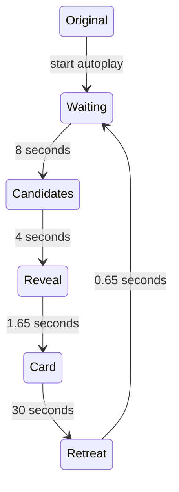

# Runtime architecture

The site is a static, Russian-language guild chronicle («Летопись гильдии»). Native browser modules,
WebGL2, and a small AssemblyScript/WebAssembly engine enhance the original
1920 × 1080 nickname collage. There is no application backend, live Armory fetch,
forum database, client framework, or CDN dependency.

## Public source and build

| Location | Responsibility |
| --- | --- |
| `src/index.html` | Canonical HTML template with message keys, accessible native controls, and a no-JavaScript Discord link |
| `src/motion.ts` | Motion phases, timing, pulse membership, selection queue, and transforms |
| `app/postcard.mjs` | Initialization, one page clock, input intent, settings, and lifecycle coordination |
| `app/motion.mjs` | Thin WASM adapter retaining one shared transform view |
| `app/renderer.mjs` | Background repair and selected/pulsing glyph rendering |
| `app/edge-fog.mjs`, `app/background-flow.mjs` | Edge atmosphere, moving background, protected foreground, and memory previews |
| `app/pointer-input.mjs`, `app/presentation.mjs` | Pixel-mask contact detection, thread/frame geometry, and placement exclusions |
| `app/card.mjs` | Dated character details, main/alt navigation, and forum-image rotation |
| `app/screenshot-scene.mjs`, `app/memory-viewer-shader.mjs` | Three preview slots, shuffled memories, modal carousel, and finite fullscreen transitions |
| `app/floating-controls.mjs` | Docked/floating settings, dragging, keyboard movement, and focus |
| `app/i18n.mjs`, `app/locales/ru.mjs` | Message lookup, document localization, and shared date/number formatting |
| `assets/` | Only selected, publication-ready images and generated textures |

`npm run build` writes `index.html` and `app/motion.wasm`. It localizes the
HTML before JavaScript runs and computes SHA-384 integrity attributes for the
entry module and stylesheets. The compiler uses the pinned AssemblyScript
version, optimized output, and the stub runtime. `npm run test:build` rebuilds
in temporary storage and compares both outputs byte-for-byte.

The same digest versions each integrity-checked asset's URL through a `v` query
parameter. Changed entry assets therefore receive fresh browser/CDN cache keys
without disabling integrity validation. Imported modules and media keep their
existing URLs.

Generated outputs are committed for the existing branch-based GitHub Pages
publication. `src/` is not served. See [deployment](deployment.md) for the
release procedure and [CONTRIBUTING](../CONTRIBUTING.md) for local commands.

## Data and identity

The current curated set contains:

| Data | Count | Public source |
| --- | ---: | --- |
| Catalogue entries: 51 placed names and 16 picker-only records | 67 | `app/nicknames.json` |
| Artwork occurrences | 65 | `app/nicknames.json` |
| Card records: 75 Armory characters, 12 historical characters and 22 historical nicknames | 109 | `app/armory-snapshot.json` |
| Groups with an owner-confirmed main | 13 | `app/armory-snapshot.json` |
| Groups with rank-inferred main/alt roles | 3 | `app/armory-snapshot.json` |
| Historical groups without an identified main | 2 | `app/armory-snapshot.json` |
| Forum source records | 56 | `app/forum-media.json` |
| Forum gallery entries | 28 | `app/forum-media.json` |
| Screenshot memories | 51 | `app/screenshots.json` |

A **catalogue entry** identifies a selectable nickname or historical forum record,
not necessarily a current character or guild member. `nicknames` holds the logical
entries; `occurrences` holds only measured places in the artwork, with their own
lettering, bounds, masks, contacts and optional peak scale. One or two occurrences
share a card; switching places preserves the chosen alt and gallery position.
An entry with no readable location explicitly uses `placement: catalog-only`.
It remains available in the alphabetic picker without invented lettering.

Picker-only presentation is explicit UI state outside the WASM selection queue.
It pauses automatic nickname selection, has no glyph, contact, thread or pulse,
and uses the same logo/memory/viewport exclusions as a placed card. Dismissal
restores the previous automatic preference; Original and Escape retain their
animation-off behavior. The optional scenery flag on `motion.advance` keeps
the existing WASM-owned effect clock moving without a synthetic glyph index.
Reduced motion and fullscreen-memory suspension still stop that clock.

Three labels use an explicit `characterId` and screenshot-note `evidence`:
Йор → Маляфка; Пивли → Маргок; Часотка → Уззбагойззя.
Two further character continuities were confirmed by the owner:
Пандемоний → Пандем462D1D and Фордана → Фордан85213C.
Their evidence uses `kind: owner-confirmed-character`, `confirmedOn` and `note`,
not an invented screenshot number or an automatic suffix-stripping rule.
Cards preserve «На коллаже: …» and distinguish owner confirmation from a
note-derived association. Validation requires the corresponding evidence and
a known target; grouped aliases must resolve to a member of that group.
No font substitution or source-JPEG change makes the lettering interactive.

Максиус is a separate owner-confirmed historical main, not another spelling
of Максис. Its `recordKind: historical-character` and dated
`binding.kind: owner-confirmed-character` preserve that distinction. The card
starts on Максиус, followed by Максис and Эрамид as alts. No current Armory
profile, realm, rank or statistics are established for Максиус; those fields
remain null, the Armory link and snapshot date stay hidden, and the card
explicitly says that the Armory character is not established. The original
notes linking both alts remain in the group evidence.

Historical forum-only records use `recordKind: historical-nickname`; an explicitly
declared old game character uses `historical-character` with an `archive-character`
binding and source URL. Neither kind fabricates a current realm, rank, statistics,
Armory URL or snapshot date. A genuine profile or personal application is not proof
of guild membership. Historical sources remain separate from current game data.

All 34 recovered profile-observation groups and six personal recruitment/return
applications are represented. Approved legacy Zuz/XpaH/aliniada continuities join
the Риннка/Храндор/Алиниада cards. Other reused account numbers remain distinct:
legacy Сириус/37 is not friendly Милагрос/37, and friendly lis/5 declares Рилья,
not Силиврен. Profile-history entries retain their URL generation and capture date.

Джонрембо's owner-confirmed avatar and independently observed friendly member140
reference have separate provenance. Эйнар's `av-209.png` is a deliberate exception:
the owner permitted displaying this candidate with a visible number-only
attribution warning, not confirmation of ownership. Other numeric filenames are
not automatically assigned. Galleries omit smaller copies of the same portrait;
different historical pictures, such as Диса's older thumbnail, remain available.

Сэвиор/Savior's declaration of Дарко and Теффи/Jamie's mention of Тефф are rendered
as dated `historicalDeclarations`, not alt groups or rename claims.
A source-only forum record may omit its gallery, but needs an actual evidence URL.
Recovered profile links and other evidence links remain distinct.

An **Armory record** is a dated observation, not live game state. The existing
66-character projection remains dated 2026-11-07. Nine newly eligible characters
have separately observed public guild fields and actual rendered links from
2026-11-09 UTC; their per-record `observedOn` overrides the unchanged snapshot date.
Screenshot rank/achievement evidence remains independent. Exact name matches
do not establish historical ownership; unavailable individual-profile fields
remain null rather than fabricated.

Seven individual profile pages supplied specialization, average item level and
achievement points. Observed matching profile values take precedence over the
guild-page cache: Риннка's profile reports level 76 while the guild row reports
75, and profile-localized class/race names can differ. The other 59 profile
requests returned HTTP 500; their independently observed roster values remain
usable, but unavailable profile details are not fabricated or zero-filled.
The observation date does not mean every character last logged in that day.

A **character group** records an independently evidenced relationship.
Thirteen groups have an owner-confirmed main. Existing roles remain unchanged:
Шпицпатрик → Эрсул;
Квилл → Квиллерс, Квиллпал, Квиллшам, Квинки, Квинтилья;
Дийкстра → Самтупой, Реннфри, Йеннефер, Консервочка;
Милагрос → Розмэри; Риогалл → Ремор, Хидд, Шамишка, Эридария, Эллеона;
Кутюрье → Ивэр, Леттера, Лиарэль, Милинара, Тулачермет;
Кривонос → Рыжебород, Таэнпиро; Соулсторм → Кликбум, Перекрутка;
Храндор → Панкотроник; Максиус → Максис, Эрамид; Шиора → Диса, Оцелора.
The last six main choices were confirmed on 2026-11-08, independently of
guild rank. Existing screenshot notes retain their original provenance.
The migration adds Хадли → Волчанка and
Эндис → Кортум, Пакди, Чиирик, Эндигуард, with owner-confirmed mains.
Хадли's dated historical application and Эндис's existing screenshot notes remain
independent supporting evidence, not the basis for automatically choosing a main.

Three additional groups have explicitly marked, rank-inferred roles:
Асканий → Дилема; Белыйволк → Джови; Лихон → Кареха, Летрикс.
Only independently linked groups with exactly one non-«Твинк» character and
all remaining members ranked «Твинк» qualify. Armory rank indices must agree
with the screenshot titles. The cards say «Вероятный основной» / «Вероятный альт»,
not that the player confirmed those roles.

`roleInference` records `kind: single-non-twink`, `assessedOn`,
`armoryObservedOn` and `rosterSourceId`; the original roster-note association
and its evidence remain intact. These are curated snapshot conclusions, not
new ownership links or a live rank-based reassignment. Validation rejects
unmarked inference, missing/conflicting rank evidence, unlinked alts, stale
snapshot provenance, or attempts to apply inference to an owner-confirmed main.
Owner-confirmed groups retain precedence regardless of rank:
Дийкстра is a confirmed main with Рекрут while Самтупой is an alt with Рейдер.

Two historical groups deliberately have no main: Остр / Остич / Jassim / Ostr
and Чернодел / зелес. Their `evidenceKind: archive-self-report` retains a dated
`capturedOn` and `evidenceUrl`, with every member marked `related`.
The distinct Latin `Ostr` is not silently folded into Cyrillic `Остр`.
These cards start on the selected nickname and omit main/alt badges.
Multiple non-twinks, higher rank, level, achievements or a note's direction
do not identify a main. Validation rejects an unconfirmed main in a self-report.
Owner-confirmed alias resolutions are recorded separately in
`rosterSource.aliasConfirmations`: Дий and Дийкстратор resolve to Дийкстра,
Мила to Милагрос, and Рио to Риогалл. Group evidence retains the original note
and its resolved alias; this does not invent a new character for the alias.
Милагрос and Риогалл were subsequently confirmed as mains independently.

Ten owner-supplied in-game roster screenshots received on 2026-11-07 supply
separate `rosterObservation` records. Capture dates are unknown; receipt is not
an observation timestamp. These fields remain separate from the refreshed
Armory projection. Screenshot rank titles take precedence in the card, and
screenshot achievement points fill only missing Armory values, with a distinct
tooltip. The initial screenshot-only records have now been enriched from their
exact-name current roster matches; their screenshot evidence and character
groups are unchanged. This does not establish rename or transfer continuity.

The combined Armory/screenshot observations identify zero-based rank indices
0/1/2/3/4/5/6 as Мастер/Офицер/Ветеран/Рейдер/Странник/Твинк/Рекрут
for the matched records. This corrects the earlier assumption that index 2
meant Странник. All seven currently observed index-5 characters have a
corresponding «Твинк» screenshot title. Rank is not a combat role or proof of
whose alt a character is. Abbreviated, truncated or ambiguous notes are not merged.

A **forum source record** contains the selected historical account, gallery,
identity evidence and an archive profile URL only when a genuine profile was
recovered. `profileHistory` preserves the accepted account generations and their
actual captures; the primary link is the newest recovered profile in that accepted
history, not a fabricated archive timestamp. Other account references link to
their actual source pages through `evidenceUrl`.
Equal filename indices are not identity proof. Image-level
`attributionKind: member-number-only` makes the approved Эйнар caveat visible
and clears it on unrelated cards. Raw biographies, contact fields and captured
forum scripts are not imported.

Cards with no selected forum image display the owner-supplied guild emblem from
`assets/forum/guild-default.webp`. `forum-media.json` records its local URL and
original Discord CDN source under `defaultImage`; visitors do not fetch the CDN.
The emblem has a localized default-image description, is not attributed to the
character or counted as a historical gallery entry, and does not rotate. Existing
portraits, gallery rotation and candidate-attribution warnings take precedence.

Only selected material is public. Raw forum files, logs, credentials, unmatched
nickname research, and private prototype/evidence records remain outside Git
history. There is no IP-address-based identification or hidden database lookup
in the application. The public build never reads those private collections.

## Glyph masks and background repair

These two asset roles are deliberately different; their suffixes are not swapped:

| Asset | Stored pixels | Rendering role |
| --- | --- | --- |
| `*-mask.png` | White RGB with antialiased glyph coverage in alpha | Defines lettering shape, hit testing, enlargement, material, outline, and glow |
| `*-repair.png` | Reconstructed background RGB with coverage around the old strokes in alpha | Covers the original nickname before the enlarged lettering is drawn |

A repair can look like a dark silhouette of the word because only the old ink
and its fringe need replacement. It is not the displayed glyph. The shader
reads the mask's **alpha**, not its white RGB, for the lettering.

Every frame repairs all original positions before drawing any moving glyph.
This prevents a later background patch from erasing a neighbouring enlarged
nickname. In full-background-flow mode the repair alpha still defines coverage,
but color comes from the shared moving background texture.

Masks and repairs remain lossless PNG. The opaque shared background uses
lossless WebP: 2,180,280 → 1,678,240 bytes, with zero changed RGBA values in both
Pillow and Chromium comparisons. The foreground with partial alpha remains PNG:
a WebP candidate preserved stored pixels but changed Chromium's decoded values.
Do not optimize these resources based on an encoder's “lossless” flag alone.
The original JPEG is not re-encoded by the public build.

## Motion, input, and placement

The automatic sequence is:

The reveal first travels along the thread for 0.75 seconds, then grows the card
frame over 0.90 seconds. Selected lettering and its connected frame can sway.
The pulse-count setting defaults to 12 artwork occurrences; candidate selection
and the active card are managed separately from ambient pulses.

The first deliberate nickname contact can open a card immediately. Once a card
is open, crossing another nickname does not replace it unless the pointer stays
there for **one second**. Click, touch, keyboard, and the picker support explicit
selection. Manual takeover of the same automatic card does not replay its reveal.

Mouse contacts use cached alpha planes and exact segment/grid intersections.
The thread begins at the actual lettering contact and exits opposite the incoming
mouse direction. Automatic selection chooses a random facing-edge ink point
and angled direction, rather than always using the nickname center.

Card geometry avoids the protected central artwork, controls, and memory slots,
including the frame's sway envelope. Memory placement uses interior margins,
other previews, and card exclusions. If space is insufficient, a preview is
deferred instead of covering another element. Fullscreen viewing preserves the
pinned card, selected alt, gallery cursor, and original manual thread contact.

## Memories and fullscreen effects

The 51 fullscreen originals comprise 31 images from the first selected screenshot
batch, 19 from the second, and one from the third. Full-size files retain their
source bytes. Preview WebP images fit within 960 × 540 without upscaling.
The second batch's 604 × 378 images remain at source resolution; AI upscaling
is not part of this release.

A shuffled deck feeds up to three permanent preview slots. Previews remain
grayscale, use a three-second reveal, hold for twelve seconds, and dissolve over
three seconds, with staggered pauses. The four preview treatments include the
original soft reveal plus fog, wave, and dust variants.

Hover intent or explicit activation opens a native modal dialog. Its canvas
contains the full-size screenshot without an interactive image element under
the pointer. Left/right buttons, arrow keys, and horizontal swipes browse the
entire collection, wrapping at either end. Predominantly vertical gestures do
not change the selected memory. Escape, the close icon, and the letterbox area
close the viewer. Returning focus does not leave a frame around the thumbnail;
normal Tab navigation still shows its focus indicator.

Five fullscreen effects share a finite 1.5-second clock. Their target setting
has intentionally distinct semantics:

| Target | Initial image | What the effect changes |
| --- | --- | --- |
| Цветности | Entire opaque grayscale screenshot | Color only; image opacity stays full |
| Изображению | Hidden screenshot whose RGB is already full color | Image visibility only; no grayscale phase |
| Изображению и цветности | Grayscale reveal | Image visibility first, then a delayed color front |

In the combined mode, image reveal completes at 72% of the transition and the
color front starts at 28%. Every mode finishes at the original image colors.
Settings apply to the next opening; a running opening uses its captured choices.
The source texture is sampled once per fragment and the reveal field is shared
between image and color calculations.

Fullscreen navigation cancels stale requests with tokens. Late decodes cannot
replace a newer selection or reopen a closed dialog. Hidden-page loads are
retained for application on return; neither the chronicle nor its gallery clocks
advance while the modal is open.

## Defaults and accessibility

Fresh loads hide the settings panel, dock it to the left, enable three memories,
and select Весь фон слева направо, Серебряный рельеф, Бегущий блик, Туманный проём,
and Изображению и цветности. Settings are local to the current page session.

Docked and floating settings are fixed-position overlays, not layout columns.
Opening, hiding, dragging or docking the panel must leave the artwork's position
and size unchanged. Card placement still accounts for the visible panel's bounds.

Character cards default to circular controls. The «Кнопки карточки» setting also
offers compact square edge buttons and bottom navigation. Every close/arrow button
has a centered 28 × 28 visible shape inside a 44 × 44 native hit target; arrows
are exact mirrors. Circular arrows align with the avatar/details row, compact
arrows with the card center, and bottom arrows flank the character counter.
Switching layouts moves existing controls without resetting the selected alt,
avatar gallery, or motion phase, then recalculates the frame/thread placement.
Cards without alternate characters hide navigation in every layout.
All three layouts reserve the same 44px side rails, including cards without
alternates. Headings, portraits and source links share a left edge; revealing
arrows or changing their style cannot change the content column's width or
horizontal position. Side arrows are positioned outside that column rather than
adding grid columns or conditional padding. Bottom navigation adds only height.

User-facing language distinguishes the guild chronicle from its historical
collage. Existing `postcard` file names, DOM identifiers and localization keys
remain technical identifiers, not the product's displayed name.

Reduced motion disables automatic startup, ambient movement, gallery rotation,
and animated transitions. Explicit card and carousel navigation still works;
automatic card cycling can be started deliberately with static transitions.
Риннка's animated GIF has a static counterpart for this preference, retaining
the same gallery position and original-image link.

Native buttons, selects, dialog modality, labels, icon tooltips, and focus
restoration support keyboard/touch use. The image-specific browser toolbar is
avoided by directing pointer input to controls/canvas surfaces, not by disabling
the browser's general context menu or claiming control over browser extensions.
Without JavaScript or the required GPU/WASM support, the original artwork remains.

## Resource and lifecycle invariants

- WASM allocates its arrays once at initialization. JavaScript retains one
  `Float32Array` view; frame updates do not copy the complete state.
- Rendering is scheduled only while animation or a finite transition requires
  it. Hidden pages suspend scheduling and resume without consuming hidden time.
- Full-size screenshots load on demand; three reusable preview slots bound
  simultaneous preview work. The fullscreen shader stops after its transition.
- A persisted `pagehide` suspends work without destroying resources. `pageshow`
  resumes the existing document. A real departure disposes owned resources.
- Main WebGL context loss leaves the original-artwork fallback active even after
  visibility changes; it cannot reactivate disposed renderers. Viewer-only
  context loss closes the viewer and can recover independently.
- Removed development snapshot APIs are not part of the public runtime contract.

## Localization and maintenance

All visible messages and accessibility labels use catalog keys. Only Russian
ships now. Adding English means supplying a complete catalog, registering it in
`app/i18n.mjs`, and rebuilding the HTML; no parallel translated templates are
needed. Character names and historical source data are not machine-translated.

Update the public JSON projections and selected assets together. Keep evidence,
dates, uncertainty, and main/alt confirmation separate. Run the checks described
in [CONTRIBUTING](../CONTRIBUTING.md), then exercise the changed browser behavior.
Third-party support/icon licenses are listed in the
[notices](../tools/THIRD-PARTY-NOTICES.md).
