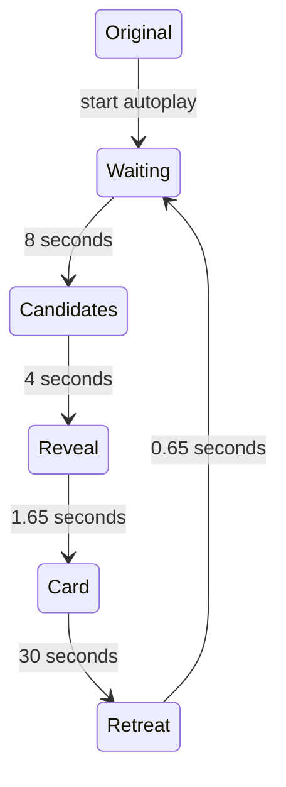

# Runtime architecture

The site is a static, Russian-language guild postcard. Native browser modules,
WebGL2, and a small AssemblyScript/WebAssembly engine enhance the original
1920 × 1080 nickname collage. There is no application backend, live Armory fetch,
forum database, client framework, or CDN dependency.

## Public source and build

| Location | Responsibility |
| --- | --- |
| `src/index.html` | Canonical HTML template with message keys, accessible native controls, and a no-JavaScript Discord link |
| `src/motion.ts` | Motion phases, timing, pulse membership, selection queue, and transforms |
| `app/postcard.mjs` | Initialization, one page clock, input intent, settings, and lifecycle coordination |
| `app/motion.mjs` | Thin WASM adapter retaining one shared transform view |
| `app/renderer.mjs` | Background repair and selected/pulsing glyph rendering |
| `app/edge-fog.mjs`, `app/background-flow.mjs` | Edge atmosphere, moving background, protected foreground, and memory previews |
| `app/pointer-input.mjs`, `app/presentation.mjs` | Pixel-mask contact detection, thread/frame geometry, and placement exclusions |
| `app/card.mjs` | Dated character details, main/alt navigation, and forum-image rotation |
| `app/screenshot-scene.mjs`, `app/memory-viewer-shader.mjs` | Three preview slots, shuffled memories, modal carousel, and finite fullscreen transitions |
| `app/floating-controls.mjs` | Docked/floating settings, dragging, keyboard movement, and focus |
| `app/i18n.mjs`, `app/locales/ru.mjs` | Message lookup, document localization, and shared date/number formatting |
| `assets/` | Only selected, publication-ready images and generated textures |

`npm run build` writes `index.html` and `app/motion.wasm`. It localizes the
HTML before JavaScript runs and computes SHA-384 integrity attributes for the
entry module and stylesheets. The compiler uses the pinned AssemblyScript
version, optimized output, and the stub runtime. `npm run test:build` rebuilds
in temporary storage and compares both outputs byte-for-byte.

The same digest versions each integrity-checked asset's URL through a `v` query
parameter. Changed entry assets therefore receive fresh browser/CDN cache keys
without disabling integrity validation. Imported modules and media keep their
existing URLs.

Generated outputs are committed for the existing branch-based GitHub Pages
publication. `src/` is not served. See [deployment](deployment.md) for the
release procedure and [CONTRIBUTING](../CONTRIBUTING.md) for local commands.

## Data and identity

The current curated set contains:

| Data | Count | Public source |
| --- | ---: | --- |
| Canonical nicknames | 30 | `app/nicknames.json` |
| Artwork occurrences | 44 | `app/nicknames.json` |
| Character records, including alts | 37 | `app/armory-snapshot.json` |
| Owner-confirmed main/alt groups | 3 | `app/armory-snapshot.json` |
| Forum profiles | 9 | `app/forum-media.json` |
| Forum gallery entries | 12 | `app/forum-media.json` |
| Screenshot memories | 51 | `app/screenshots.json` |

A **nickname** is the canonical card identity. An **occurrence** is one measured
place in the artwork, with its own lettering, bounds, masks, contacts, and
optional peak scale. One or two occurrences share a card; selecting the other
occurrence does not reset that card's chosen alt or gallery position.

An **Armory record** is a dated observation, not live game state. The current
snapshot was observed on 2026-11-06 for Странники, EU / Король-лич. Exact
case-insensitive name matching is marked as such and does not prove historical
identity. Owner-confirmed profile URLs are distinguished from name matches.
Missing character details are not fabricated.

A **character group** is a separately confirmed relationship. Its first member
is the main character and the remaining members are alts. Current groups are
Шпицпатрик → Эрсул; Квилл → Квиллерс, Квиллпал, Квиллшам, Квинки, Квинтилья;
and Дийкстра → Самтупой. Guild rank is not a combat role. The confirmed displayed
rank numbers 2, 3, and 4 map to Офицер, Странник, and Рейдер; the source's rank
index is zero-based. Unknown rank names remain unknown rather than inferred.

A **forum profile** records its historical member ID, selected gallery images,
identity evidence, and an archive URL only when established. Equal filename
indices can support curation but are not proof of identity by themselves.
Archive links identify observed captures; they do not assert that an exhaustive
latest-capture search has been completed for every person.

Only selected material is public. Raw forum files, logs, credentials, unmatched
nickname research, and private prototype/evidence records remain outside Git
history. There is no IP-address-based identification or hidden database lookup
in the application. The public build never reads those private collections.

## Glyph masks and background repair

These two asset roles are deliberately different; their suffixes are not swapped:

| Asset | Stored pixels | Rendering role |
| --- | --- | --- |
| `*-mask.png` | White RGB with antialiased glyph coverage in alpha | Defines lettering shape, hit testing, enlargement, material, outline, and glow |
| `*-repair.png` | Reconstructed background RGB with coverage around the old strokes in alpha | Covers the original nickname before the enlarged lettering is drawn |

A repair can look like a dark silhouette of the word because only the old ink
and its fringe need replacement. It is not the displayed glyph. The shader
reads the mask's **alpha**, not its white RGB, for the lettering.

Every frame repairs all original positions before drawing any moving glyph.
This prevents a later background patch from erasing a neighbouring enlarged
nickname. In full-background-flow mode the repair alpha still defines coverage,
but color comes from the shared moving background texture.

Masks and repairs remain lossless PNG. The opaque shared background uses
lossless WebP: 2,180,280 → 1,678,240 bytes, with zero changed RGBA values in both
Pillow and Chromium comparisons. The foreground with partial alpha remains PNG:
a WebP candidate preserved stored pixels but changed Chromium's decoded values.
Do not optimize these resources based on an encoder's “lossless” flag alone.
The original JPEG is not re-encoded by the public build.

## Motion, input, and placement

The automatic sequence is:

The reveal first travels along the thread for 0.75 seconds, then grows the card
frame over 0.90 seconds. Selected lettering and its connected frame can sway.
The pulse-count setting defaults to 12 artwork occurrences; candidate selection
and the active card are managed separately from ambient pulses.

The first deliberate nickname contact can open a card immediately. Once a card
is open, crossing another nickname does not replace it unless the pointer stays
there for **one second**. Click, touch, keyboard, and the picker support explicit
selection. Manual takeover of the same automatic card does not replay its reveal.

Mouse contacts use cached alpha planes and exact segment/grid intersections.
The thread begins at the actual lettering contact and exits opposite the incoming
mouse direction. Automatic selection chooses a random facing-edge ink point
and angled direction, rather than always using the nickname center.

Card geometry avoids the protected central artwork, controls, and memory slots,
including the frame's sway envelope. Memory placement uses interior margins,
other previews, and card exclusions. If space is insufficient, a preview is
deferred instead of covering another element. Fullscreen viewing preserves the
pinned card, selected alt, gallery cursor, and original manual thread contact.

## Memories and fullscreen effects

The 51 fullscreen originals comprise 31 images from the first selected screenshot
batch, 19 from the second, and one from the third. Full-size files retain their
source bytes. Preview WebP images fit within 960 × 540 without upscaling.
The second batch's 604 × 378 images remain at source resolution; AI upscaling
is not part of this release.

A shuffled deck feeds up to three permanent preview slots. Previews remain
grayscale, use a three-second reveal, hold for twelve seconds, and dissolve over
three seconds, with staggered pauses. The four preview treatments include the
original soft reveal plus fog, wave, and dust variants.

Hover intent or explicit activation opens a native modal dialog. Its canvas
contains the full-size screenshot without an interactive image element under
the pointer. Left/right buttons, arrow keys, and horizontal swipes browse the
entire collection, wrapping at either end. Predominantly vertical gestures do
not change the selected memory. Escape, the close icon, and the letterbox area
close the viewer. Returning focus does not leave a frame around the thumbnail;
normal Tab navigation still shows its focus indicator.

Five fullscreen effects share a finite 1.5-second clock. Their target setting
has intentionally distinct semantics:

| Target | Initial image | What the effect changes |
| --- | --- | --- |
| Цветности | Entire opaque grayscale screenshot | Color only; image opacity stays full |
| Изображению | Hidden screenshot whose RGB is already full color | Image visibility only; no grayscale phase |
| Изображению и цветности | Grayscale reveal | Image visibility first, then a delayed color front |

In the combined mode, image reveal completes at 72% of the transition and the
color front starts at 28%. Every mode finishes at the original image colors.
Settings apply to the next opening; a running opening uses its captured choices.
The source texture is sampled once per fragment and the reveal field is shared
between image and color calculations.

Fullscreen navigation cancels stale requests with tokens. Late decodes cannot
replace a newer selection or reopen a closed dialog. Hidden-page loads are
retained for application on return; neither the postcard nor its gallery clocks
advance while the modal is open.

## Defaults and accessibility

Fresh loads hide the settings panel, dock it to the left, enable three memories,
and select Весь фон слева направо, Серебряный рельеф, Бегущий блик, Туманный проём,
and Изображению и цветности. Settings are local to the current page session.

Docked and floating settings are fixed-position overlays, not layout columns.
Opening, hiding, dragging or docking the panel must leave the artwork's position
and size unchanged. Card placement still accounts for the visible panel's bounds.

Reduced motion disables automatic startup, ambient movement, gallery rotation,
and animated transitions. Explicit card and carousel navigation still works;
automatic card cycling can be started deliberately with static transitions.
Риннка's animated GIF has a static counterpart for this preference, retaining
the same gallery position and original-image link.

Native buttons, selects, dialog modality, labels, icon tooltips, and focus
restoration support keyboard/touch use. The image-specific browser toolbar is
avoided by directing pointer input to controls/canvas surfaces, not by disabling
the browser's general context menu or claiming control over browser extensions.
Without JavaScript or the required GPU/WASM support, the original artwork remains.

## Resource and lifecycle invariants

- WASM allocates its arrays once at initialization. JavaScript retains one
  `Float32Array` view; frame updates do not copy the complete state.
- Rendering is scheduled only while animation or a finite transition requires
  it. Hidden pages suspend scheduling and resume without consuming hidden time.
- Full-size screenshots load on demand; three reusable preview slots bound
  simultaneous preview work. The fullscreen shader stops after its transition.
- A persisted `pagehide` suspends work without destroying resources. `pageshow`
  resumes the existing document. A real departure disposes owned resources.
- Main WebGL context loss leaves the original-artwork fallback active even after
  visibility changes; it cannot reactivate disposed renderers. Viewer-only
  context loss closes the viewer and can recover independently.
- Removed development snapshot APIs are not part of the public runtime contract.

## Localization and maintenance

All visible messages and accessibility labels use catalog keys. Only Russian
ships now. Adding English means supplying a complete catalog, registering it in
`app/i18n.mjs`, and rebuilding the HTML; no parallel translated templates are
needed. Character names and historical source data are not machine-translated.

Update the public JSON projections and selected assets together. Keep evidence,
dates, uncertainty, and main/alt confirmation separate. Run the checks described
in [CONTRIBUTING](../CONTRIBUTING.md), then exercise the changed browser behavior.
Third-party support/icon licenses are listed in the
[notices](../tools/THIRD-PARTY-NOTICES.md).
